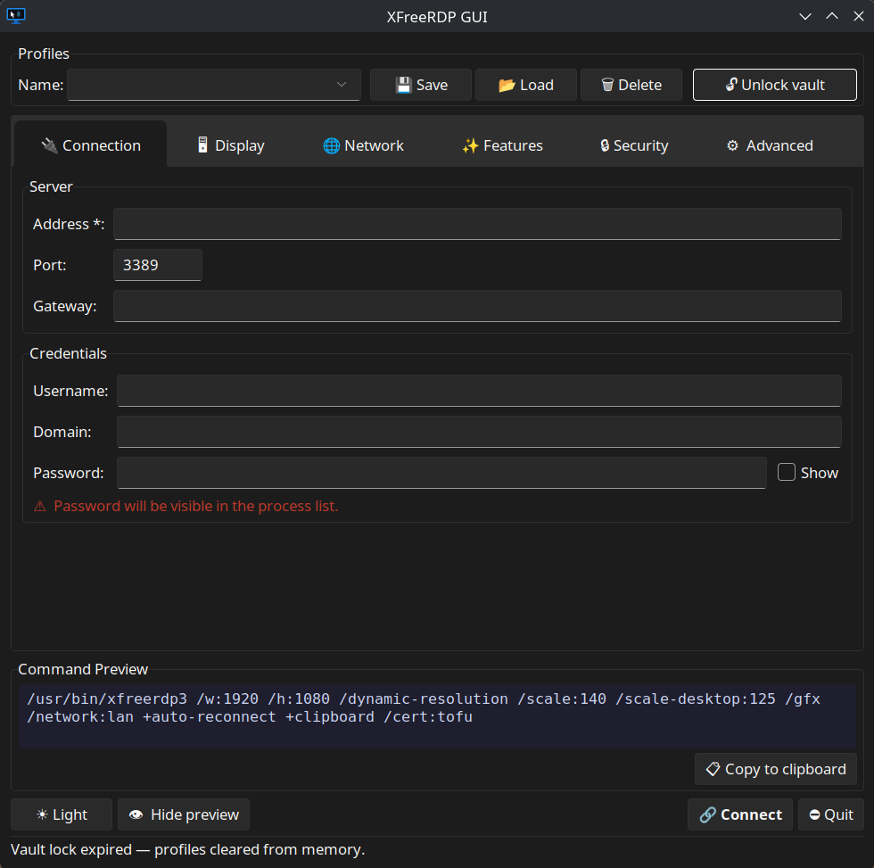
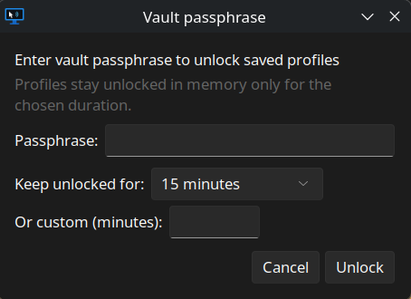

#  XFreeRDP GUI

A graphical frontend for [FreeRDP](https://www.freerdp.com/) on Linux. Build and launch `xfreerdp` connections through a point-and-click interface — no need to remember command-line flags.




---

## Features

- Save and load named connection profiles in an **encrypted vault** (passphrase-protected, at-rest encryption, no plaintext credentials on disk)
- **Configurable vault unlock duration** — keep profiles available in memory for 1 min, 5 min, 15 min, 30 min, 1 hour, 1 day, 7 days, or a custom duration; profiles are cleared automatically when the timer expires
- **System tray mode** — the app starts minimized to the tray; unlock the vault, list your profiles, and connect directly from the tray menu
- Configure resolution, color depth, and rendering options
- Network quality presets and auto-reconnect settings
- Device redirection: clipboard, audio, microphone, printer, USB, drives
- Remote App (`/app:`) support
- Certificate and security protocol options (**trust-on-first-use by default**, with a warning before connecting with certificate validation disabled)
- Advanced flags: custom FreeRDP arguments, `/admin`, etc.
- Live command preview showing the exact `xfreerdp` command that will be run — **with the password masked**
- Input validation for port, resolution, and retry counts
- Drive redirection paths support `~/` and `$VAR` expansion
- Dark / Light theme toggle (uses [sv-ttk](https://github.com/rdbende/Sun-Valley-ttk-theme) when available, otherwise a built-in dark/light theme)

---

## Requirements

| Requirement | Notes |
|---|---|
| **Linux** (Debian/Ubuntu/Fedora/Arch or compatible) | Tested on Ubuntu 26.04+ and KDE Plasma 6 |
| **Python 3.10+** | `python3 --version` to check |
| **python3-tk** | Tkinter GUI toolkit |
| **xfreerdp** (FreeRDP 2.4+/3.x) | The underlying RDP client (older 2.x used `/cert-ignore` instead of `/cert:ignore`) |

---

## Installation

### 1. Install system dependencies

**Debian / Ubuntu / Linux Mint**
```bash
sudo apt update
sudo apt install python3 python3-tk freerdp2-x11
# For the system tray:
sudo apt install gir1.2-ayatanaappindicator3-0.1 gir1.2-gtk-3.0
```

> For FreeRDP 3.x (where available):
> ```bash
> sudo apt install freerdp3-x11
> ```

**Fedora / RHEL / CentOS Stream**
```bash
sudo dnf install python3 python3-tkinter freerdp
# For the system tray:
sudo dnf install libayatana-appindicator-gtk3 gtk3
```

**Arch Linux / Manjaro**
```bash
sudo pacman -S python tk freerdp
# For the system tray:
sudo pacman -S libayatana-appindicator
```

**openSUSE**
```bash
sudo zypper install python3 python3-tk freerdp
```

> **GNOME users:** stock GNOME has no system tray. Install the AppIndicator shell extension, then log out and back in:
> - Debian/Ubuntu: `sudo apt install gnome-shell-extension-appindicator`
> - Fedora: `sudo dnf install gnome-shell-extension-appindicator`
>
> The app exits at startup with instructions if it detects GNOME without this extension. KDE, XFCE, MATE, Cinnamon, and Budgie work out of the box.
> Without tray support at all, the app still runs as a normal window.

### 2. Clone the repository

```bash
git clone https://github.com/NumLockx/XFreeRDP.git
cd XFreeRDP
```

### 3. (Optional but recommended) Create a virtual environment

```bash
python3 -m venv .venv
source .venv/bin/activate
```

### 4. (Optional) Install the sv-ttk theme

The Sun Valley theme provides a polished Windows 11-style appearance. The app works without it, falling back to a built-in dark/light theme.

```bash
pip install sv-ttk
```

### 5. Run the application

```bash
chmod +x run.sh
./run.sh
```

Or directly with Python:

```bash
python3 main.py
```

On first launch the app starts minimized to the system tray. Click the tray icon → **Unlock vault…** to set your vault passphrase and begin saving profiles.

### Project layout

| File | Purpose |
|---|---|
| `main.py` | Application window, command builder, profile UI |
| `vault.py` | Encrypted-at-rest profile storage (PBKDF2 + HMAC) |
| `storage.py` | Vault/session management and settings persistence |
| `dialogs.py` | Tooltips and the vault unlock / password / drive dialogs |
| `tray.py` | System tray icon via Ayatana AppIndicator |
| `common.py` | Paths, atomic file I/O, input validation |
| `run.sh` | Launcher (uses `.venv` if present) |

---

## Build an AppImage

This repository includes a build script that packages the app as a single `.AppImage`.

### Requirements for AppImage build

- `python3` and `pip`
- `appimagetool` (from [AppImageTool releases](https://github.com/AppImage/appimagetool/releases/tag/continuous))
- `python3-tk` on the **build** machine (the bundler needs to find tkinter)

Example:
wget https://github.com/AppImage/appimagetool/releases/download/continuous/appimagetool-x86_64.AppImage \
     -O ~/.local/bin/appimagetool
chmod +x ~/.local/bin/appimagetool

nano ~/.bashrc
export PATH="$HOME/.local/bin:$PATH"

---

Install build-only Python dependency:

```bash
python3 -m pip install --user pyinstaller
```

### Build command

```bash
chmod +x scripts/build_appimage.sh
./scripts/build_appimage.sh
```

Output file:

```bash
build/appimage/XFreeRDP-GUI-<arch>.AppImage
```

Notes:

- The AppImage bundles the GUI app runtime.
- `xfreerdp` itself is still expected on the target system (`xfreerdp` in `PATH`).
- The Ayatana/GTK system libraries for the tray **cannot be bundled**; they must be present on the target system (see the tray packages in step 1). Without them the app degrades gracefully to windowed mode with an explanatory popup.

---

## Add to the application menu

Install the desktop entry for the current user with correct paths baked in automatically:

```bash
chmod +x install.sh
./install.sh
```

This creates `~/.local/share/applications/xfreerdp-gui.desktop` pointing at your checkout. Refresh the desktop database if the entry doesn't appear immediately:

```bash
update-desktop-database ~/.local/share/applications/
```

---

## Configuration

Everything is stored in `~/.config/xfreerdp-gui/`:

| File | Contents |
|---|---|
| `profiles.vault` | Encrypted connection profiles (created on first unlock) |
| `settings.json` | UI preferences (theme, preview visibility) |
| `profiles.json` | *Legacy* — old plaintext profiles. You'll be offered a one-time migration into the vault; afterwards the file is renamed to `profiles.json.migrated` |

Files are written atomically with owner-only permissions (`0600`). If `settings.json` ever fails to parse, it is preserved as `settings.json.corrupt-N` rather than overwritten.

### About the vault

- The passphrase is used to derive an encryption key (PBKDF2, 600k iterations) and is held **only in memory**, and only while the vault is unlocked.
- Choose the unlock duration when entering the passphrase. When the timer expires, decrypted profiles are cleared from memory and the tray profile list disappears until you unlock again.
- **There is no recovery.** If you forget the passphrase, the vault cannot be opened.
- Passwords are also passed to `xfreerdp` on its command line, which is visible in the system process list for the lifetime of the connection (this is inherent to how `xfreerdp` works). Leave the password field empty in a profile to be prompted in the GUI instead and keep it out of your saved profiles entirely.

### Security defaults

- Certificate validation defaults to `tofu` (trust-on-first-use, like SSH). Connecting with validation set to `ignore` requires confirming a warning first.
- Port, resolution, and retry values are validated before connecting.

---

## Using the tray

- The app starts minimized to the tray.
- **Unlock vault…** opens the passphrase popup directly — no main window needed.
- Once unlocked, the tray menu lists your saved profiles; click one to connect (password prompt appears in a popup if needed).
- **Open Main Window** shows the full GUI.
- **Lock vault** immediately clears profiles from memory; the countdown is shown in the main window's lock button.
- Closing the main window minimizes back to the tray. **Quit** (tray or window) exits the app — running RDP sessions stay alive independently until you close them.

---

## Keyboard Shortcuts

| Shortcut | Action |
|---|---|
| `Ctrl+Enter` | Connect |
| `Ctrl+S` | Save current profile |

---

## Uninstall

1. Remove the application files:
   ```bash
   rm -rf /path/to/XFreeRDP
   ```
2. Remove the desktop entry (if installed):
   ```bash
   rm ~/.local/share/applications/xfreerdp-gui.desktop
   ```
3. Remove saved profiles, vault, and settings:
   ```bash
   rm -rf ~/.config/xfreerdp-gui
   ```

---

## Troubleshooting

**`python3-tk is not installed` error**
Install Tkinter for your distribution (see installation step 1) and re-run.

**`xfreerdp: command not found`**
Install FreeRDP (see step 1). Verify with `xfreerdp --version`.

**No tray icon appears (GNOME)**
Install and enable the AppIndicator shell extension (see installation step 1), then log out and back in. Without it, the app shows a popup explaining this and exits.

**No tray icon on other desktops**
Check that the tray/status-notification widget is enabled in your panel, and that the Ayatana packages from step 1 are installed (`gir1.2-ayatanaappindicator3-0.1 gir1.2-gtk-3.0` on Debian/Ubuntu). Newly registered icons sometimes hide in the tray's overflow popup — look behind the arrows. The app falls back to windowed mode (with an explanatory popup) if tray support is missing.

**A `libayatana-appindicator is deprecated` warning prints on startup**
Harmless — it's a notice from the system library itself, not an error. It doesn't appear when launched from the desktop entry.

**Wrong vault passphrase / vault rejected**
You get up to three attempts. If the vault file is corrupted (rare), restore it from a backup of `~/.config/xfreerdp-gui/` — there is no passphrase recovery.

**A drive redirection with `$HOME` or `~` doesn't mount**
`~/` and `$VAR` are expanded when connecting, not when saving — so the variable must exist in the environment of the user running the app. Paths with commas can't be used (FreeRDP parses on the first comma).

**Window icon is missing**
The icon is generated from `icon.svg` at startup. Install one of the following converters and restart:
```bash
sudo apt install librsvg2-bin   # provides rsvg-convert (recommended)
# or
sudo apt install imagemagick    # provides convert
# or
sudo apt install inkscape
```

**Theme looks plain / no Sun Valley theme**
Install sv-ttk inside your virtual environment:
```bash
source .venv/bin/activate
pip install sv-ttk
```

---

## License

This project is provided as-is. See the repository for license details.
